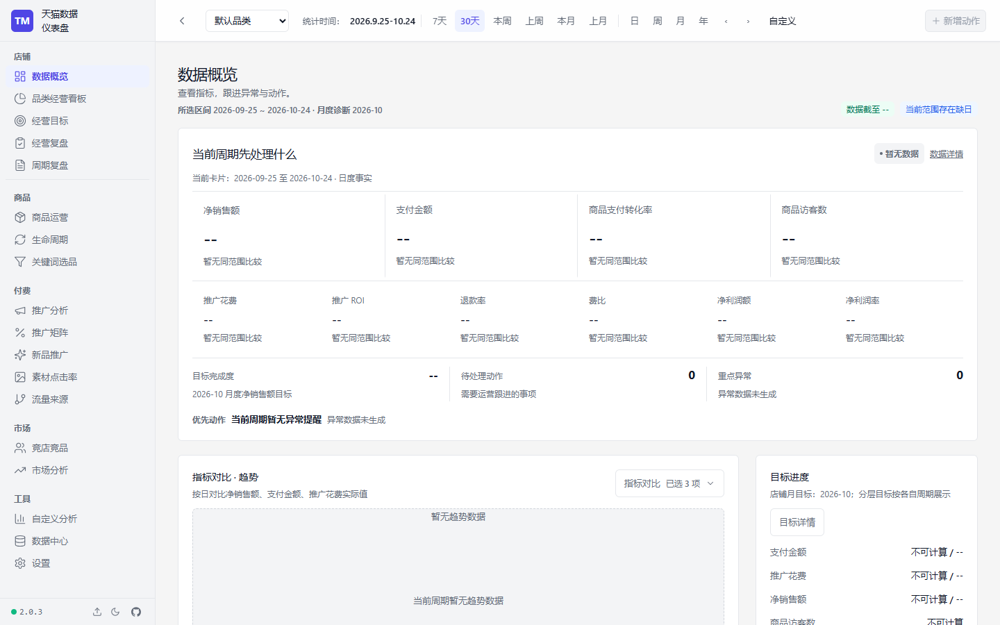
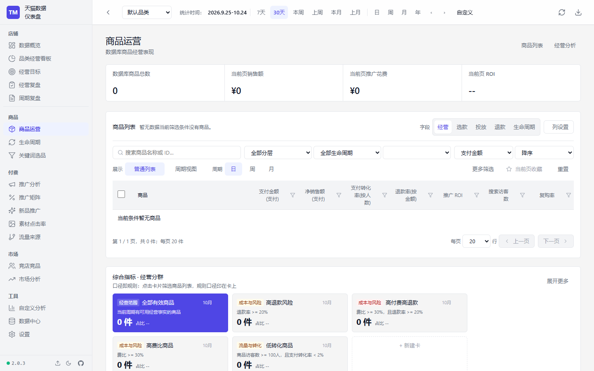
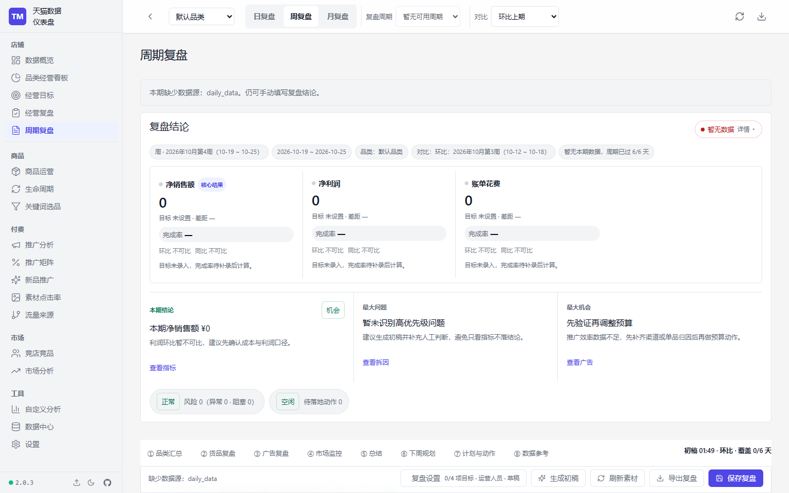
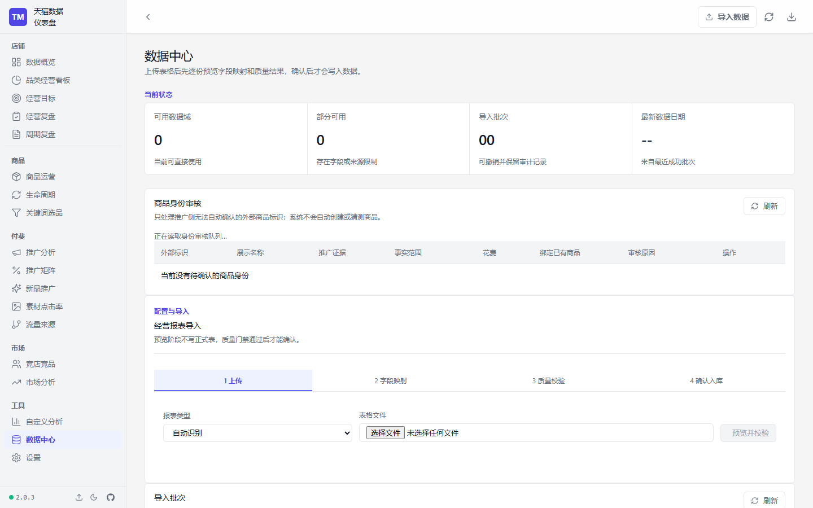

# 天猫数据仪表盘

[](https://github.com/owen891/tmall-dashboard/releases)


面向单店铺运营团队的经营分析与商品运营工作台。系统以 Flask、SQLite 和原生 HTML/CSS/JavaScript 构建，把经营结果、商品表现、推广投放、生命周期、行动复盘和数据治理放在同一套可追溯流程中。

当前版本：`v2.1.0`（已发布 [GitHub Release](https://github.com/owen891/tmall-dashboard/releases) 与桌面安装包，支持在线更新）。详细变更见 [更新说明](CHANGELOG.md)。

## 产品界面

总览先给出净销售额、转化、目标进度和待处理动作；商品运营承接筛选、分析和行动；数据中心负责导入、校验、审计与来源治理。以下截图来自空数据演示环境，仅展示界面结构与交互。

| 数据概览 | 商品运营 |
|---|---|
|  |  |

| 周期复盘 | 数据中心 |
|---|---|
|  |  |

## 核心能力

| 能力 | 说明 |
|---|---|
| 经营分析 | 总览决策台、品类经营看板、经营目标、经营/周期复盘（含目标差距归因与利润瀑布） |
| 商品运营 | 商品分层与货品矩阵、生命周期、商品对比与经营异常提示 |
| 推广分析 | 推广汇总及计划、单元、创意、地域等已导入粒度的下钻分析，推广矩阵与素材点击率 |
| 市场分析 | 竞店竞品、市场排行、蓝海词与趋势节点 |
| 数据接入 | Excel、旧版 HTML `.xls`、CSV、ZIP 手动导入与受控目录定时扫描 |
| 数据治理 | 字段映射、质量门禁、批次审计、来源 observation/lineage 与冲突安全撤销 |
| 发布防护 | 生产预检、数据库备份恢复、店铺隔离检查和发布审计 |

## 数据来源策略

重复字段不做简单覆盖，以业务系统的权威来源为准；DMP 用于交叉参考、补充缺失以及承接其他表格没有的独有字段。

| 字段类型 | 主来源 | DMP 角色 |
|---|---|---|
| 生意与转化指标 | 生意参谋 | 参考或缺失补充 |
| 推广花费与归因指标 | 推广工具 | 参考或缺失补充 |
| 搜索、推荐、预售、复购、连带购买等独有字段 | DMP | 有效来源 |

导入时保留 `source_type`、源批次、字段映射、质量摘要和写入审计。缺失或不足的数据展示为“无数据 / 数据不足”，不会用 `0` 或推测值填充。

## 快速开始

当前发布基线使用 Python 3.14：

```powershell
py -3 -m venv .venv
.\.venv\Scripts\Activate.ps1
py -3 -m pip install -r requirements.txt
py -3 app.py
```

`requirements.txt` 是人工维护的直接依赖清单；需要可复现构建（桌面打包、生产部署）时改用含传递依赖的完整锁定文件：

```powershell
py -3 -m pip install -r requirements-lock.txt
```

升级依赖后必须重新导出 `requirements-lock.txt` 并同步 `requirements.txt`，避免两者漂移。

打开 `http://127.0.0.1:5000/`。主工作台包括总览、商品运营、推广分析、生命周期、经营复盘、数据中心和设置。

Web 版会通过 `/api/version` 检查当前发布版本；检测到服务器已发布新版本时，页面顶部会提示刷新，刷新后加载新的前端资源。Web 版的实际升级仍由服务器部署流程完成，浏览器不会直接覆盖服务器文件。

### 在线升级流程

- **Web 版：** 页面启动、回到前台以及定时检查 `/api/version?client=web`。服务端版本高于页面内置版本时显示“更新说明”和“立即刷新”；刷新只重新加载已部署的 Web 资源，不会修改服务器文件。管理员需要先完成服务器部署，浏览器端只负责发现和加载新版本。
- **桌面版：** Electron 启动时会检查 GitHub Releases，托盘菜单和设置页也可以手动检查。发现新版本后先询问是否下载，下载完成后再询问是否重启安装；安装前会停止内置 Flask/Waitress 服务，避免数据库或后端文件被占用。开发环境不会触发在线更新。
- **更新源：** 桌面端优先使用国内 GitCode Release `https://gitcode.com/owen891/tmall-dashboard/releases/latest/download`，失败时回退到 GitHub。Windows 必须同时发布 `latest.yml`、`TmallDashboard-Setup-<version>-x64.exe` 和对应 `.blockmap`；macOS 必须发布合并后的 `latest-mac.yml`、x64/arm64 的 `.dmg`、`.zip` 及对应 `.blockmap`。这些文件由 `desktop-release.yml` 在 Windows 和 macOS runner 上生成后统一上传。
- **版本约束：** `VERSION`、`desktop/package.json`、`desktop/package-lock.json`、Web 版本资源和更新元数据必须使用同一个三段式版本号；当前发布基线为 `VERSION=2.1.0`，对应 tag `v2.1.0`。只推送匹配的 `v*` tag 才会触发桌面 Release，不能从普通分支手动生成更新元数据。
- **macOS 前提：** 当前 workflow 会在 Intel 与 Apple Silicon runner 分别构建并合并更新索引。下载安装包不要求本机先安装开发工具；要让 macOS 自动更新顺利安装，发布环境还应配置有效的 Apple Developer 签名和公证凭据，否则用户仍可从 Release 页面手动下载包，但系统可能拦截未签名应用或自动安装。

## Windows 桌面版

桌面版将 Electron 窗口、Chromium 和 PyInstaller Flask/Waitress 后端一起打包，目标电脑不需要预装 Python、Node.js、浏览器或 WebView2。首次安装包可离线运行；在线更新从公开 GitHub Releases 下载。

本地构建 Windows x64 安装包：

```powershell
.\scripts\build_desktop.ps1
```

本地构建 macOS x64 或 Apple Silicon 产物（需在对应 macOS 环境执行）：

```bash
npm ci --prefix desktop
python scripts/sync_desktop_version.py
python scripts/build_backend.py
npm run dist:mac --prefix desktop -- --x64
# Apple Silicon：将 --x64 改为 --arm64
```

Windows 产物位于 `desktop/release/`，包含 NSIS 安装器、blockmap 和 `latest.yml`；macOS 产物包含 `.dmg`、`.zip` 和 `latest-mac.yml`。

```powershell
git fetch --tags origin
git checkout --detach origin/main
git clean -fdx
(Get-Content VERSION -Raw).Trim()
git tag v2.1.0
git push origin v2.1.0
```

标签必须与根目录 `VERSION` 完全一致（当前 `VERSION=2.1.0` 对应 `v2.1.0`）。`desktop-release.yml` 只允许 `push` 的 `v*` 标签进入发布；手动 `workflow_dispatch` 不会发布，避免从非 tag 提交创建 Release。Windows 与 macOS 使用相同的 Python/Node 运行时、锁定依赖和桌面测试，构建完成后由单一串行 job 合并并发布 Release。真实浏览器门禁由 `quality-gate.yml` 执行，不由桌面发布 workflow 重复执行。

本地运行真实浏览器门禁前安装仓库依赖和 Chromium：

```powershell
npm ci --prefix desktop
npx --prefix desktop playwright install chromium
$env:TMALL_SMOKE_BASE = 'http://127.0.0.1:8770'
node scripts/smoke_core_pages.cjs
node scripts/audit_core_interactions.cjs
```

发布审计要求干净工作树，并检查敏感产物、数据库完整性、导入批次和事实 observation/lineage；发布前可单独执行 `py -3 scripts/release_audit.py --database data/dashboard.db --strict`。

## 生产启动

本机生产运行使用 Waitress。先备份 SQLite 数据库并配置 Basic Auth，再启动服务：

```powershell
Copy-Item data/dashboard.db data/dashboard.db.bak
$env:DASHBOARD_USERNAME = 'operator'
$env:DASHBOARD_PASSWORD = 'replace-with-a-long-random-password'
& .\scripts\start_production.ps1 -BackupBeforeStart
```

启动前可运行只读预检，启动后检查健康状态：

```powershell
py -3 scripts/production_preflight.py
Invoke-WebRequest http://127.0.0.1:5000/healthz | Select-Object -ExpandProperty Content
```

只有健康检查返回 `"ok": true` 且 `"database": "ok"` 才可开放访问。

## 数据导入与定时扫描

数据中心支持多文件预览、字段映射、质量校验和事务确认。受控目录扫描与手动导入共用同一套 `ImportService`、质量门禁和批次审计协议。

Web 版填写的是运行 Flask 服务主机上的本地目录，浏览器不会把用户电脑路径授权给服务器；目录仍必须位于 `IMPORT_SCAN_ALLOWED_ROOTS` 允许根目录内。桌面版在 `TMALL_DESKTOP_MODE=1` 时显示原生文件夹选择器。需要多人分权时可额外设置 `IMPORT_SCAN_VIEW_USERS` 和 `IMPORT_SCAN_MANAGE_USERS`，它们只控制扫描 API 能力，不会写入普通系统设置。


```powershell
py -3 scripts/run_import_scanner.py --once
```

扫描器只处理允许目录的直接子文件；文件连续两次保持稳定后才进入导入。质量不通过的文件会保留为阻塞或失败记录，并支持显式重试。

## 验证状态

发布前建议依次运行：

```powershell
py -3 -m unittest discover -s tests -v
Get-ChildItem frontend/ui_demo/assets -Filter *.js | ForEach-Object { node --check $_.FullName }
node scripts/validate_ui_demos.cjs
py -3 scripts/production_preflight.py
py -3 scripts/production_preflight.py --recovery-source data/dashboard.db
py -3 scripts/release_audit.py --database data/dashboard.db --strict
```

浏览器门禁覆盖七个 API 驱动主页面、响应式视口、图表像素输出、错误状态和横向溢出；发布审计会检查脏工作树、未核验批次、数据库完整性和来源血缘。

## 已知限制

> **生产数据血缘：** 已根据可核验的原始生意参谋工作簿补齐此前 **277 条**历史日事实的 observation/lineage；回填脚本具备来源哈希校验、冲突拒绝和幂等保护。后续生产库变更仍须通过 `py -3 scripts/release_audit.py --database data/dashboard.db --strict` 审计。

- 推广计划、单元、创意、地域和内容归因只有在对应粒度事实导入后才开放，下钻不会构造不存在的数据。
- 生命周期判断需要至少 60 个连续有效日；季节性判断需要 12 个完整自然月，数据不足时明确显示“数据积累中”。
- 周/月事实及部分依赖旧表的工具接口仍限定单店结构；非 `default` 店铺请求会返回 `UNSUPPORTED_SCOPE`，避免静默串店。
- `main` 与当前发布分支存在独立提交历史，后续合并应通过显式 Pull Request 审查，不直接覆盖默认分支。
- **本机沙箱降权（2026-10-10 确认）：** 当前机器对 `.venv\Scripts\python.exe` 所在路径的进程强制降权为 Low Integrity Level，导致该解释器无法在系统 TEMP 目录创建 SQLite/文件（`tempfile.gettempdir()` 会回退到仓库根目录，测试子进程备份步骤曾因此失败）。影响仅限「用 `.venv` 解释器执行且需要在系统 TEMP 写文件」的场景；按 README 用 `py -3 -m unittest` 验证不受影响，相关测试已改用 `sys.executable` 运行被测脚本。若在别的机器复现 `unable to open database file` 类错误，先检查 venv 解释器进程的完整性级别。

## 发布

当前版本 `v2.0.3` 已发布 [GitHub Release](https://github.com/owen891/tmall-dashboard/releases/latest)（含 Windows x64 安装包，支持在线更新）。
